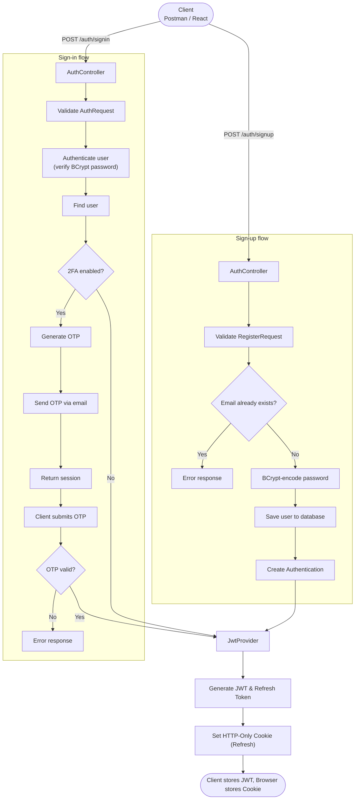
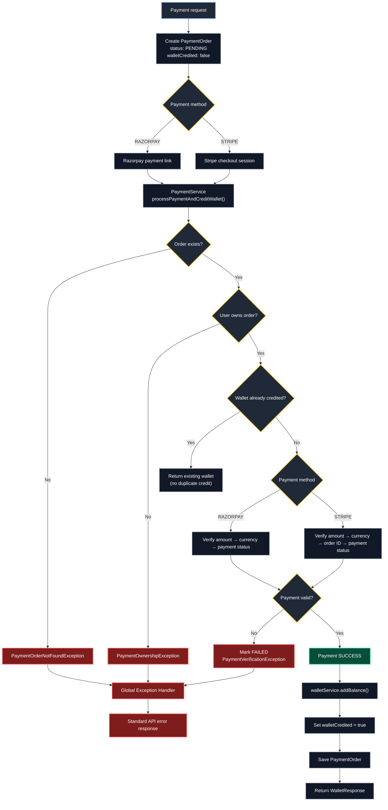

<div align="center">

# TradeForge ⚡

**A full-stack cryptocurrency trading and portfolio management platform.**

Execute trades, manage digital wallets, track real-time market data, process secure fiat-to-crypto payments, and get AI-powered trade insights.

[](https://spring.io/projects/spring-boot)
[](https://reactjs.org/)
[](#%EF%B8%8F-database-architecture)
[](#-event-driven-architecture)
[](#-core-features)
[](https://openjdk.org/)

</div>

---

## 📑 Table of Contents

- [Overview](#-overview)
- [System Architecture](#%EF%B8%8F-system-architecture)
- [Core Features](#-core-features)
- [Technology Stack](#%EF%B8%8F-technology-stack)
- [Security & Authentication](#-security--authentication)
- [Payment Processing Engine](#-payment-processing-engine)
- [Database Architecture](#%EF%B8%8F-database-architecture)
- [Getting Started](#-getting-started)
- [Configuration](#%EF%B8%8F-configuration)
- [Project Structure](#-project-structure)
- [Roadmap](#%EF%B8%8F-roadmap)

---

## 🔭 Overview

TradeForge is engineered for scale and correctness. It combines a stateless, secure authentication layer, a transactional order execution engine (supporting limit and stop-loss orders), an event-driven architecture using Kafka, a double-entry wallet ledger, and an idempotent multi-gateway payment pipeline behind a React-based trading terminal.

### Repositories

TradeForge is split across two repositories:

| Repository | Description |
| :--- | :--- |
| **[TradeForge](https://github.com/Biikash1/TradeForge)** (this repo) | Spring Boot backend: REST API, security, Kafka trading engine, wallet, and Gemini AI |
| **[TradeForge-Frontend](https://github.com/Biikash1/TradeForge-Frontend)** | React + Redux + Tailwind CSS trading terminal |

---

## 🏛️ System Architecture

```mermaid
flowchart TD

    subgraph group_identity["Identity and security"]
        node_auth_api["Authentication API"]
        node_user_api["User API"]
        node_user_service["User service<br/>[UserService.java]"]
        node_verification["OTP verification"]
        node_email["Email delivery<br/>[EmailService.java]"]
    end

    subgraph group_market["Market and portfolio"]
        node_market_api["Coin API"]
        node_coin_service["Market data service<br/>[CoinService.java]"]
        node_price_stream["Price streaming"]
        node_portfolio["Portfolio analytics"]
        node_watchlist["Watchlists"]
    end

    subgraph group_trading["Trading execution"]
        node_order_api["Order API"]
        node_order_service["Order service<br/>[OrderService.java]"]
        node_execution["Order execution engine"]
    end

    subgraph group_finance["Wallets and payments"]
        node_payment_api["Payment API"]
        node_payment_service["Payment service"]
        node_wallet_service["Wallet service<br/>[WalletService.java]"]
    end

    subgraph group_platform["Persistence and integrations"]
        node_user_store[("User records<br/>[User.java]")]
        node_verification_store[("Verification records")]
        node_coin_store[("Coin records<br/>[Coin.java]")]
        node_order_store[("Order records<br/>[Order.java]")]
        node_payment_store[("Payment orders<br/>[PaymentOrder.java]")]
        node_wallet_store[("Wallet ledger")]
    end

    node_client(("Trading client"))
    node_payment_gateways{{"Razorpay and Stripe"}}

    node_client -->|"authenticates"| node_auth_api
    node_client -.->|"manages profile"| node_user_api
    node_client -.->|"requests market data"| node_market_api
    node_client -->|"places orders"| node_order_api
    node_client -.->|"starts payment"| node_payment_api
    node_auth_api -->|"saves users"| node_user_store
    node_auth_api -->|"sends OTP"| node_email
    node_user_api -->|"loads users"| node_user_service
    node_user_api -->|"creates and verifies codes"| node_verification
    node_user_api -->|"sends OTP"| node_email
    node_verification -.->|"persists codes"| node_verification_store
    node_market_api -->|"requests coins"| node_coin_service
    node_coin_service -.->|"manages coin data"| node_coin_store
    node_price_stream -->|"reads prices"| node_coin_service
    node_client -.->|"views portfolio"| node_portfolio
    node_client -.->|"manages watchlist"| node_watchlist
    node_order_api -->|"submits orders"| node_order_service
    node_execution -->|"loads pending orders"| node_order_store
    node_execution -->|"fetches current price"| node_coin_service
    node_execution -->|"dispatches execution"| node_order_service
    node_order_service -.->|"persists orders"| node_order_store
    node_payment_api -.->|"processes payments"| node_payment_service
    node_payment_service -.->|"tracks payment orders"| node_payment_store
    node_payment_service -->|"credits wallet"| node_wallet_service
    node_wallet_service -.->|"records ledger entries"| node_wallet_store
    node_payment_service -.->|"verifies payment"| node_payment_gateways

    classDef toneNeutral fill:#f8fafc,stroke:#334155,stroke-width:1.5px,color:#0f172a
    classDef toneBlue fill:#dbeafe,stroke:#2563eb,stroke-width:1.5px,color:#172554
    classDef toneAmber fill:#fef3c7,stroke:#d97706,stroke-width:1.5px,color:#78350f
    classDef toneMint fill:#dcfce7,stroke:#16a34a,stroke-width:1.5px,color:#14532d
    classDef toneRose fill:#ffe4e6,stroke:#e11d48,stroke-width:1.5px,color:#881337
    classDef toneIndigo fill:#e0e7ff,stroke:#4f46e5,stroke-width:1.5px,color:#312e81
    classDef toneTeal fill:#ccfbf1,stroke:#0f766e,stroke-width:1.5px,color:#134e4a
    class node_auth_api,node_user_api,node_user_service,node_verification,node_email,node_client toneBlue
    class node_market_api,node_coin_service,node_price_stream,node_portfolio,node_watchlist toneAmber
    class node_order_api,node_order_service,node_execution toneMint
    class node_payment_api,node_payment_service,node_wallet_service toneRose
    class node_user_store,node_verification_store,node_coin_store,node_order_store,node_payment_store,node_wallet_store,node_payment_gateways toneIndigo

```



## 🚀 Core Features

| Feature | Description |
| :--- | :--- |
| **Advanced Order Execution** | Market, Limit, and Stop-Loss buy/sell orders managed by a scheduled execution engine. |
| **Event-Driven Architecture** | Asynchronous trade processing and email/WebSocket notifications using Apache Kafka. |
| **AI Trade Assistant** | Integrated Google Gemini AI for real-time crypto insights and pre-trade risk analysis. |
| **Real-Time Market Data** | Live cryptocurrency pricing via WebSockets (STOMP) and CoinGecko API integration with Redis caching. |
| **Double-Entry Wallet System** | Internal ledger for user balances, idempotent top-ups, and withdrawal processing. |
| **Institutional-Grade Security** | Stateless JWT authentication, Refresh Tokens, BCrypt hashing, and Email OTP-based 2FA. |
| **Multi-Gateway Payments** | Fiat deposits via Razorpay and Stripe with automated, secure wallet crediting. |
| **Rate Limiting** | Bucket4j & Redis rate limiting protecting core trading APIs and AI endpoints from abuse. |
| **Portfolio Analytics** | Advanced tracking of asset holdings, calculating net P&L, highest gains, and worst performers. |

---

## 🛠️ Technology Stack

| Layer | Technologies |
| :--- | :--- |
| **Backend Core** | Java 21, Spring Boot, Spring Data JPA, Hibernate |
| **Messaging & Events** | Apache Kafka, Zookeeper |
| **Caching & Rate Limiting** | Redis, Bucket4j, Spring Cache |
| **Security** | Spring Security, JWT (w/ Refresh Tokens), BCrypt, JavaMail |
| **Database** | MySQL 8.0 |
| **External APIs** | Razorpay, Stripe, CoinGecko, Google Gemini AI |
| **Infrastructure** | Docker, Docker Compose |

---

## 🔐 Security & Authentication

TradeForge uses a stateless authentication mechanism. Sign-in supports optional Two-Factor Authentication (2FA). The system also manages Refresh Tokens stored securely in HTTP-Only cookies to maintain sessions without compromising short-lived JWTs.



### 💳 Payment Processing Engine

The platform implements a resilient, idempotent payment engine. Internal wallets are credited only after successful verification with the payment provider, which prevents race conditions and duplicate credits.




### 🗄️ Database Architecture

A fully normalized relational schema (3NF) on MySQL, spanning identity, wallets, trading, market data, and event idempotency.

#### Key Entities

| Entity | Description |
| :--- | :--- |
| **Users / Security** | `USERS`, `VERIFICATION_CODES`, `FORGOT_PASSWORD_TOKENS`, `TWO_FACTOR_OTP`, `REFRESH_TOKENS` |
| **Market Data** | `COINS`, `WATCHLISTS`, `WATCHLIST_COINS` |
| **Execution & Trading** | `ORDERS`, `ORDER_ITEMS`, `ASSETS` |
| **Finance & Ledger** | `WALLETS`, `WALLET_TRANSACTIONS`, `WITHDRAWALS`, `PAYMENT_ORDERS`, `PAYMENT_DETAILS` |
| **Events** | `PROCESSED_EVENTS` (Kafka idempotency tracking) |

---

## 🏁 Getting Started

### Prerequisites

- Java 21+
- Maven 3.9+ (or use the included `./mvnw` wrapper)
- Docker & Docker Compose (for local Kafka, Zookeeper, Redis, MySQL)
- Razorpay and/or Stripe test-mode accounts
- Google Gemini API Key

### 1. Clone both repositories

```bash
# Backend
git clone https://github.com/Biikash1/TradeForge.git

# Frontend
git clone https://github.com/Biikash1/TradeForge-Frontend.git
```

### 2. Spin up Local Infrastructure

TradeForge includes a `docker-compose.yaml` to instantly provision MySQL, Redis, Kafka, and Zookeeper.

```bash
cd TradeForge
docker-compose up -d

# Note: The MySQL container automatically creates the Trading database. 
# Hibernate will handle schema generation (spring.jpa.hibernate.ddl-auto=update).
```

### 3. Run the backend

```bash
./mvnw clean install
./mvnw spring-boot:run

# The API starts on http://localhost:8080. 
# Swagger documentation is available at http://localhost:8080/swagger-ui.html.
```

### 4. Run the frontend

```bash
cd ../TradeForge-Frontend
npm install
npm run dev
```

## ⚙️ Configuration

Ensure the following environment variables are set (or add them to an untracked `application-local.properties`). **Do not commit your secrets!**

| Variable | Description |
| :--- | :--- |
| `DB_URL` | e.g., `jdbc:mysql://localhost:3306/Trading` |
| `PASSWORD` | Database root password |
| `JWT_SECRET` | Secret key used to sign JWTs (use a strong Base64 encoded string) |
| `MAIL_USERNAME` <br> `MAIL_PASSWORD` | SMTP credentials for sending emails (Brevo/SendGrid/etc.) |
| `MAIL_FROM` | Verified sender email address |
| `RAZORPAY_KEY` <br> `RAZORPAY_SECRET` | Razorpay API credentials |
| `STRIPE_SECRET` | Stripe secret API key |
| `GEMINI_API_KEY` | Google Gemini AI API key |
| `COINGECKO_URL` | `https://api.coingecko.com/api/v3` (or Pro endpoint) |

---

## 📁 Project Structure

```plaintext
TradeForge/
├── src/main/java/com/cryptotrading/
│   ├── config/               # Security, JWT, WebSockets, Rate Limiting, Kafka, Redis
│   ├── controller/           # REST endpoints (Orders, Wallets, ChatBot, Portfolio)
│   ├── domain/               # Enums (OrderType, OrderStatus, etc.)
│   ├── dto/                  # Request/Response data transfer objects
│   ├── exception/            # Custom exceptions & global handler
│   ├── model/                # JPA entities
│   ├── repository/           # Spring Data JPA repositories
│   ├── service/              # Core business logic (Trading Engine, AI, Wallets)
│   │   └── kafka/            # Async TradeEvent Producer & Consumer
│   └── Utils/                # Utilities (OTP Generation)
├── src/main/resources/       # application.properties
├── docker-compose.yaml       # Infra: MySQL, Kafka, Zookeeper, Redis
├── pom.xml                   # Maven dependencies
└── README.md
```

---

## 🗺️ Roadmap

- [x] Limit and stop-loss order types (Implemented via `OrderExecutionEngine`)
- [x] WebSocket-based live price streaming (Implemented via `PriceStreamingService`)
- [x] Portfolio analytics and P&L dashboards (Implemented via `PortfolioService`)
- [x] Dockerized deployment (Added `docker-compose.yaml` for Infra)