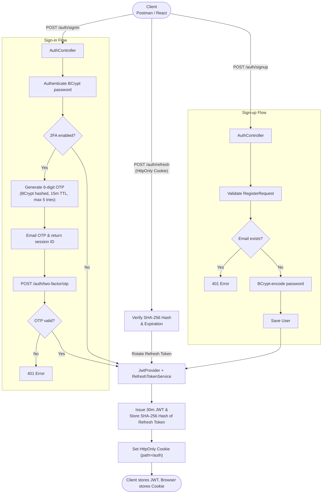
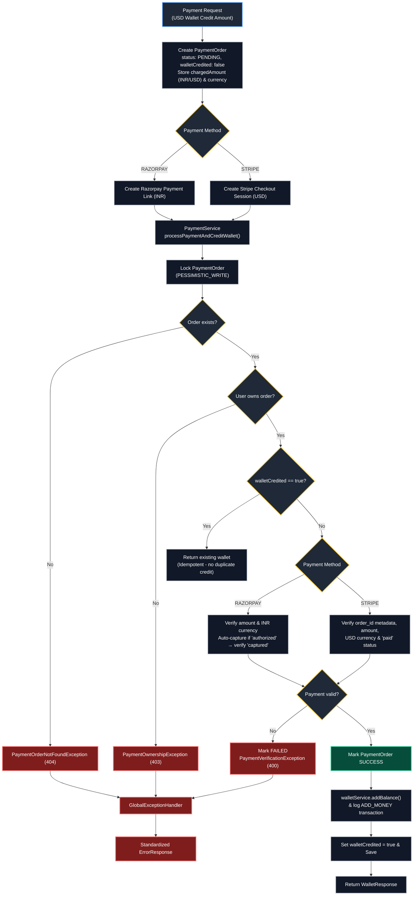

<div align="center">

# TradeForge ⚡

**A full-stack cryptocurrency trading and portfolio management platform.**

Execute market, limit, and stop-loss trades, manage transaction-logged digital wallets, stream live market data, process idempotent fiat deposits, and get AI-powered pre-trade risk insights.

[](https://spring.io/projects/spring-boot)
[](https://reactjs.org/)
[](#%EF%B8%8F-database-architecture)
[](#-event-driven-architecture)
[](#%EF%B8%8F-technology-stack)
[](#-core-features)
[](https://openjdk.org/)

</div>

---

## 📑 Table of Contents

- [Overview](#-overview)
- [System Architecture](#%EF%B8%8F-system-architecture)
- [Core Features](#-core-features)
- [Technology Stack](#%EF%B8%8F-technology-stack)
- [Security & Authentication](#-security--authentication)
- [Event-Driven Architecture](#-event-driven-architecture)
- [Payment Processing Engine](#-payment-processing-engine)
- [Database Architecture](#%EF%B8%8F-database-architecture)
- [Getting Started](#-getting-started)
- [Configuration](#%EF%B8%8F-configuration)
- [Project Structure](#-project-structure)
- [Roadmap](#%EF%B8%8F-roadmap)

---

## 🔭 Overview

TradeForge is engineered for financial correctness, concurrency safety, and resilience. It combines stateless JWT authentication with rotating hashed refresh tokens, AES-256-GCM encryption for sensitive banking data, a transactional order execution engine with funds/asset reservation and stale-price protection, a Transactional Outbox pipeline over Apache Kafka with dead-letter recovery, and an idempotent multi-gateway payment engine behind a React trading terminal.

### Repositories

TradeForge is split across two repositories:

| Repository | Description |
| :--- | :--- |
| **[TradeForge](https://github.com/Biikash1/TradeForge)** (this repo) | Spring Boot 4 backend: REST API, security, order execution engine, Transactional Outbox + Kafka, wallet ledger, Redis caching/rate limiting, and Gemini AI |
| **[TradeForge-Frontend](https://github.com/Biikash1/TradeForge-Frontend)** | React + Redux + Tailwind CSS trading terminal |

---

## 🏛️ System Architecture

```mermaid
flowchart TD

    subgraph group_identity["Identity & Security"]
        node_auth_api["Authentication API"]
        node_user_api["User API"]
        node_user_service["User Service<br/>[UserService.java]"]
        node_verification["OTP & 2FA Verification"]
        node_email["Email Delivery<br/>[EmailService.java]"]
        node_rate_limit["Redis Rate Limiter<br/>[RateLimitInterceptor.java]"]
    end

    subgraph group_market["Market, AI & Portfolio"]
        node_market_api["Coin API"]
        node_coin_service["Market Data Service<br/>[CoinService.java]"]
        node_price_stream["STOMP Price Streaming<br/>[PriceStreamingService.java]"]
        node_portfolio["Portfolio Analytics"]
        node_watchlist["Watchlists"]
        node_ai["AI Trade Assistant<br/>[ChatBotService.java]"]
    end

    subgraph group_trading["Trading Execution & Events"]
        node_order_api["Order API"]
        node_order_service["Order Service<br/>[OrderService.java]"]
        node_execution["Order Execution Engine<br/>[OrderExecutionEngine.java]"]
        node_outbox["Outbox Relay<br/>[OutboxRelayService.java]"]
        node_kafka{{"Apache Kafka<br/>(trade-events / DLT)"}}
        node_consumer["Trade Event Consumer<br/>[TradeEventConsumer.java]"]
    end

    subgraph group_finance["Wallets & Payments"]
        node_payment_api["Payment API"]
        node_payment_service["Payment Service<br/>[PaymentService.java]"]
        node_wallet_service["Wallet Service<br/>[WalletService.java]"]
        node_withdrawal["Withdrawal Service"]
    end

    subgraph group_platform["Persistence & External APIs"]
        node_mysql[("MySQL 8.0<br/>(Users, Orders, Wallets,<br/>Outbox, Processed Events)")]
        node_redis[("Redis<br/>(Market Cache &<br/>Bucket4j Buckets)")]
        node_payment_gateways{{"Razorpay & Stripe"}}
        node_external{{"CoinGecko & Gemini AI"}}
    end

    node_client(("Trading Client"))

    node_client -->|"requests"| node_rate_limit
    node_rate_limit --> node_auth_api
    node_rate_limit --> node_order_api
    node_rate_limit --> node_ai
    node_client -.->|"manages profile"| node_user_api
    node_client -.->|"requests market data"| node_market_api
    node_client -.->|"views portfolio / watchlist"| node_portfolio
    node_client -.->|"starts payment / withdrawal"| node_payment_api

    node_auth_api --> node_mysql
    node_auth_api --> node_email
    node_user_api --> node_user_service
    node_user_api --> node_verification
    node_verification --> node_email

    node_market_api --> node_coin_service
    node_coin_service --> node_redis
    node_coin_service --> node_external
    node_coin_service --> node_mysql
    node_price_stream -->|"20s broadcast"| node_client
    node_price_stream --> node_coin_service
    node_ai --> node_external

    node_order_api --> node_order_service
    node_execution -->|"20s evaluation"| node_order_service
    node_execution --> node_coin_service
    node_order_service --> node_wallet_service
    node_order_service -->|"writes order + outbox atomically"| node_mysql
    node_outbox -->|"polls unpublished events"| node_mysql
    node_outbox -->|"publishes"| node_kafka
    node_kafka --> node_consumer
    node_consumer -->|"idempotency check"| node_mysql
    node_consumer -->|"trade confirmation"| node_email
    node_consumer -->|"live WS notification"| node_client

    node_payment_api --> node_payment_service
    node_payment_service --> node_payment_gateways
    node_payment_service -->|"pessimistic lock & credit"| node_wallet_service
    node_wallet_service --> node_mysql
    node_withdrawal --> node_wallet_service

    classDef toneBlue fill:#dbeafe,stroke:#2563eb,stroke-width:1.5px,color:#172554
    classDef toneAmber fill:#fef3c7,stroke:#d97706,stroke-width:1.5px,color:#78350f
    classDef toneMint fill:#dcfce7,stroke:#16a34a,stroke-width:1.5px,color:#14532d
    classDef toneRose fill:#ffe4e6,stroke:#e11d48,stroke-width:1.5px,color:#881337
    classDef toneIndigo fill:#e0e7ff,stroke:#4f46e5,stroke-width:1.5px,color:#312e81
    class node_auth_api,node_user_api,node_user_service,node_verification,node_email,node_rate_limit,node_client toneBlue
    class node_market_api,node_coin_service,node_price_stream,node_portfolio,node_watchlist,node_ai toneAmber
    class node_order_api,node_order_service,node_execution,node_outbox,node_kafka,node_consumer toneMint
    class node_payment_api,node_payment_service,node_wallet_service,node_withdrawal toneRose
    class node_mysql,node_redis,node_payment_gateways,node_external toneIndigo
```



---

## 🚀 Core Features

| Feature | Description |
| :--- | :--- |
| **Advanced Order Execution** | Market, Limit, and Stop-Loss buy/sell orders evaluated every 20 seconds by `OrderExecutionEngine` in isolated `REQUIRES_NEW` transactions, with stale-price protection (rejects quotes older than 60s). |
| **Funds & Asset Reservation** | Pending Limit/Stop-Loss buy orders lock fiat in `reservedBalance` (handling price improvement refunds and stop-loss slippage); pending sell orders lock holdings in `reservedQuantity`. Cancellations release locks cleanly. |
| **Transactional Outbox & Kafka** | Trade events are persisted atomically to `outbox_events` alongside order fills, relayed to Kafka (`trade-events`) with broker acknowledgements, retried on failure, routed to `trade-events.DLT`, and deduplicated via `processed_events`. |
| **AI Trade Assistant** | Google Gemini AI integration supporting function-calling live coin lookups (`/api/chat`), general crypto Q&A (`/api/chat/simple`), and context-aware pre-trade risk analysis (`/api/chat/trade-insight`). |
| **Real-Time Market Data** | STOMP WebSocket streaming (`/ws`) broadcasting live prices every 20s to `/topic/public/prices` and `/topic/price/{coinId}`, backed by CoinGecko API, Redis caching (20s–1h TTLs), and DB fallback resilience. |
| **Transaction-Logged Wallet System** | Atomic balance updates with `@Version` optimistic locking (`409 Conflict` on contention), P2P wallet transfers, admin-approved withdrawals, and paginated transaction history. |
| **Defense-in-Depth Security** | Short-lived stateless JWTs (30 min), SHA-256 hashed rotating Refresh Tokens in `HttpOnly` cookies, BCrypt password/OTP hashing, Email OTP 2FA, RBAC (`ADMIN` / `CUSTOMER`), and AES-256-GCM encryption for stored bank account numbers. |
| **Multi-Gateway Payments** | Fiat deposits via Razorpay (INR with configurable USD-to-INR conversion and auto-capture) and Stripe (USD) using pessimistic row locking (`SELECT ... FOR UPDATE`) and idempotency guards. |
| **Distributed Rate Limiting** | Bucket4j + Redis rate limiting: `10 req/min` per IP on `/auth/**`, `20 req/hr` per user on `/api/chat/**`, and `80 req/min` per user on trading, transfer, and withdrawal endpoints. |
| **Portfolio Analytics** | Real-time calculation of total invested capital, current value, net P&L ($ and %), and best/worst performing assets. |

---

## 🛠️ Technology Stack

| Layer | Technologies |
| :--- | :--- |
| **Backend Core** | Java 21, Spring Boot 4.1, Spring Data JPA, Hibernate, Jackson 3 (`tools.jackson.*`) |
| **Messaging & Reliability** | Apache Kafka, Zookeeper, Transactional Outbox Pattern, Dead-Letter Topics (`DLT`) |
| **Real-Time** | Spring WebSocket (STOMP) |
| **Caching & Rate Limiting** | Redis, Spring Cache, Bucket4j (`bucket4j-redis` / Lettuce) |
| **Security & Crypto** | Spring Security, JJWT 0.13 (Gson), BCrypt, AES-256-GCM (`AttributeConverter`), JavaMail (Brevo SMTP) |
| **Database** | MySQL 8.0 |
| **External APIs** | Razorpay, Stripe, CoinGecko, Google Gemini AI |
| **API Docs & Infra** | SpringDoc OpenAPI 3 (Swagger UI), Docker, Docker Compose |

---

## 🔐 Security & Authentication

TradeForge uses stateless short-lived JWT access tokens (30 minutes) paired with 7-day Refresh Tokens stored as SHA-256 hashes in MySQL and delivered via `HttpOnly`, `SameSite=Lax` cookies scoped to `/auth`. Every `/auth/refresh` call rotates the refresh token to limit replay exposure. Sensitive bank account numbers (`PaymentDetails`) are encrypted at rest with **AES-256-GCM** using a per-record random 12-byte IV and returned masked (`****1234`) in API responses.



---

## 📨 Event-Driven Architecture

To prevent dual-write inconsistencies between MySQL and Kafka, TradeForge implements the **Transactional Outbox Pattern** with idempotent consumption and dead-letter recovery:

1. **Atomic Persistence:** When `OrderServiceImpl` fills a market or advanced order, it saves the updated `Order` and an `OutboxEvent` (`published = false`) in the same database transaction.
2. **Reliable Relay:** `OutboxRelayService` polls up to 50 unpublished events every 2 seconds, publishes them to the `trade-events` Kafka topic, waits up to 5 seconds for broker acknowledgement, and marks them `published = true`. If Kafka is unreachable, the batch halts and retries on the next cycle.
3. **Retry & Dead-Letter Topic:** `KafkaErrorConfig` configures `DefaultErrorHandler` with `FixedBackOff(2000ms, 3 retries)`. Poison messages that still fail are automatically routed by `DeadLetterPublishingRecoverer` to `trade-events.DLT`.
4. **Idempotent Consumer:** `TradeEventConsumer` checks `processed_events` by `eventId` before sending the trade confirmation email and pushing a live STOMP notification to `/topic/notifications/{userId}`.

---

## 💳 Payment Processing Engine

Internal wallets are credited only after acquiring a pessimistic database lock (`LockModeType.PESSIMISTIC_WRITE`) on the `PaymentOrder` and verifying the payment directly with Razorpay or Stripe, preventing concurrent double-crediting race conditions.



---

## 🗄️ Database Architecture

A normalized relational schema on MySQL 8.0 spanning identity, market data, order execution, financial ledgers, and reliable event delivery.

### Key Entities

| Domain | Entities / Tables |
| :--- | :--- |
| **Users & Security** | `USER`, `VERIFICATION_CODE`, `FORGET_PASSWORD_TOKEN`, `TWO_FACTOR_OTP`, `REFRESH_TOKENS` |
| **Market Data** | `COIN`, `WATCHLIST`, `WATCHLIST_COINS` |
| **Trading & Holdings** | `ORDERS`, `ORDER_ITEM`, `ASSET` (with `@Version` & `reservedQuantity`) |
| **Finance & Ledger** | `WALLET` (with `@Version` & `reservedBalance`), `WALLET_TRANSACTIONS`, `WITHDRAWAL`, `PAYMENT_ORDERS` (with `@Version`), `PAYMENT_DETAILS` (AES-GCM encrypted account number) |
| **Event Reliability** | `OUTBOX_EVENTS` (Transactional Outbox), `PROCESSED_EVENTS` (Kafka consumer idempotency) |

---

## 🏁 Getting Started

### Prerequisites

- **Java 21+**
- **Maven 3.9+** (or use the included `./mvnw` wrapper)
- **Docker & Docker Compose** (for MySQL 8.0, Redis, Kafka, and Zookeeper)
- **Razorpay** and/or **Stripe** test-mode accounts
- **Google Gemini API Key**
- **SMTP credentials** (e.g., Brevo)

### 1. Clone both repositories

```bash
# Backend
git clone [https://github.com/Biikash1/TradeForge.git](https://github.com/Biikash1/TradeForge.git)

# Frontend
git clone [https://github.com/Biikash1/TradeForge-Frontend.git](https://github.com/Biikash1/TradeForge-Frontend.git)
```

### 2. Spin up local infrastructure

`docker-compose.yaml` provisions MySQL 8.0 (auto-creating the `Trading` database), Zookeeper, Kafka (`localhost:9092`), and Redis (`localhost:6379`).

```bash
cd TradeForge
docker-compose up -d
```

### 3. Configure environment variables & run the backend

Export the required environment variables (see [Configuration](#%EF%B8%8F-configuration)) and start the Spring Boot server:

```bash
./mvnw clean install
./mvnw spring-boot:run

# API runs on http://localhost:8080
# Swagger UI: http://localhost:8080/swagger-ui.html
```

### 4. Run the frontend

```bash
cd ../TradeForge-Frontend
npm install
npm run dev
```

---

## ⚙️ Configuration

Set the following environment variables before running the application (or supply them via an untracked local profile). **Never commit secrets to version control.**

| Variable | Required | Description |
| :--- | :---: | :--- |
| `PASSWORD` | Yes | MySQL `root` password (matches `MYSQL_ROOT_PASSWORD` in `docker-compose.yaml`) |
| `JWT_SECRET` | Yes | Base64-encoded HMAC secret key for signing JWTs (at least 256-bit) |
| `ENCRYPTION_SECRET` | Yes | 32-byte (256-bit) Base64-encoded AES-GCM key for encrypting bank account numbers (`openssl rand -base64 32`) |
| `COINGECKO_URL` | Yes | CoinGecko API base URL (e.g., `https://api.coingecko.com/api/v3`) |
| `GEMINI_API_KEY` | Yes | Google Gemini API key (configured for `gemini-3.6-flash` by default) |
| `MAIL_USERNAME` <br> `MAIL_PASSWORD` | Yes | SMTP credentials (defaults to `smtp-relay.brevo.com:587`) |
| `MAIL_FROM` | Yes | Verified sender email address |
| `RAZORPAY_KEY` <br> `RAZORPAY_SECRET` <br> `RAZORPAY_CALLBACK_URL` | Yes | Razorpay API credentials and redirect callback URL |
| `STRIPE_SECRET` <br> `STRIPE_SUCCESS_URL` <br> `STRIPE_CANCEL_URL` | Yes | Stripe secret key and checkout success/cancel redirect URLs |
| `USD_TO_INR_RATE` | No | Exchange rate used for Razorpay INR charges (default: `84.00`) |
| `COOKIE_SECURE` | No | Sets the `Secure` flag on the refresh token cookie (default: `false` for local HTTP dev; set `true` in HTTPS production) |

---

## 📁 Project Structure

```plaintext
TradeForge/
├── src/main/java/com/cryptotrading/
│   ├── config/               # Security, JWT, AES-GCM Encryptor, Kafka DLT, Redis Cache, Bucket4j Rate Limit, WebSockets, Swagger
│   ├── controller/           # REST & STOMP endpoints (Auth, Users, Coins, Orders, Wallet, Payments, Withdrawals, Portfolio, Watchlist, ChatBot)
│   ├── domain/               # Enums (OrderType, OrderStatus, PaymentMethod, WalletTransactionType, WithdrawalStatus, etc.)
│   ├── dto/                  # Request/Response DTOs, TradeEvent record, GeminiDto
│   ├── exception/            # Domain exceptions & GlobalExceptionHandler (incl. 409 Optimistic Locking)
│   ├── model/                # JPA entities (User, Coin, Order, Asset, Wallet, PaymentOrder, PaymentDetails, OutboxEvent, ProcessedEvent, etc.)
│   ├── repository/           # Spring Data JPA repositories (incl. Pessimistic Write Lock queries)
│   ├── service/              # Core business logic (OrderExecutionEngine, PriceStreamingService, RateLimitingService, RefreshTokenService, etc.)
│   │   └── kafka/            # OutboxRelayService, TradeEventProducer, TradeEventConsumer
│   └── Utils/                # OtpUtils (SecureRandom 6-digit OTP generator)
├── src/main/resources/       # application.properties
├── src/test/                 # Context load & unit tests (OrderExecutionEngineTest, PaymentServiceImplTest)
├── docker-compose.yaml       # Local infrastructure: MySQL 8.0, Kafka, Zookeeper, Redis
├── pom.xml                   # Maven dependencies (Spring Boot 4.1, Java 21)
└── README.md
```

---

## 🗺️ Roadmap

- [x] Limit and stop-loss order execution with funds/asset reservation (`OrderExecutionEngine`)
- [x] Transactional Outbox pattern with Kafka Dead-Letter Topic (`OutboxRelayService`, `KafkaErrorConfig`)
- [x] AES-256-GCM field-level encryption for bank account details (`AesEncryptor`)
- [x] Distributed Redis + Bucket4j rate limiting (`RateLimitInterceptor`)
- [x] Rotating SHA-256 hashed refresh tokens in `HttpOnly` cookies (`RefreshTokenService`)
- [x] WebSocket-based live price streaming & trade notifications (`PriceStreamingService`)
- [x] Portfolio analytics and P&L dashboards (`PortfolioServiceImpl`)
- [x] Dockerized local infrastructure (`docker-compose.yaml`)